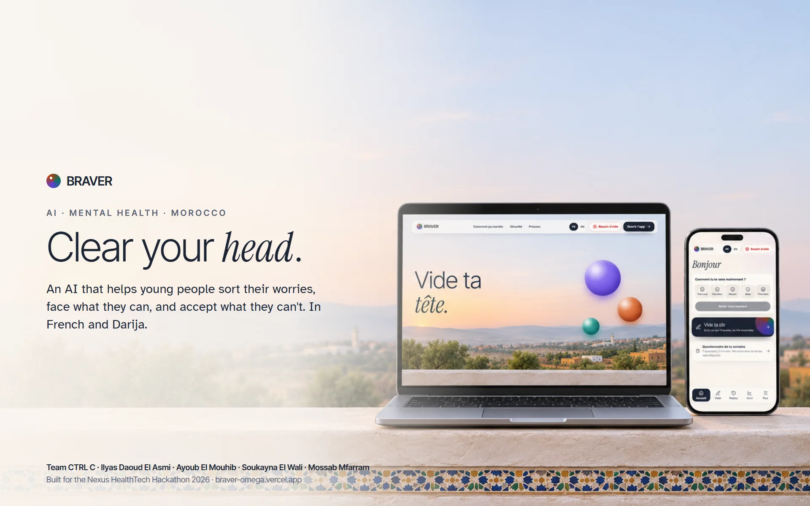
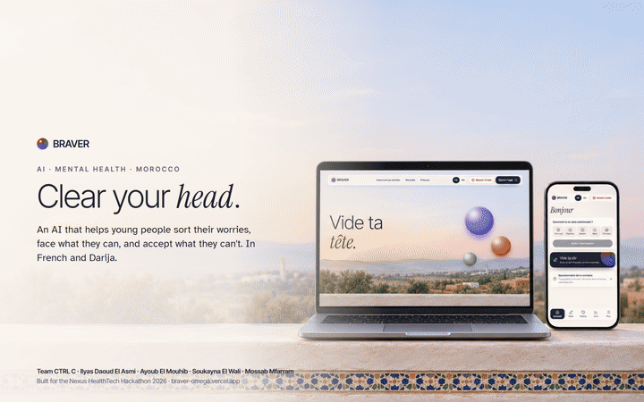
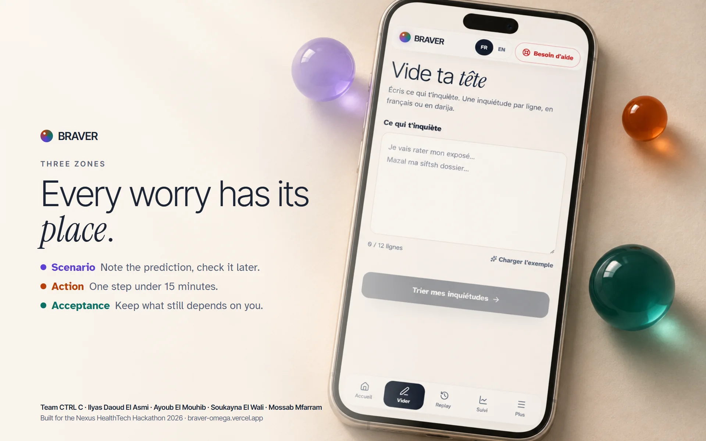
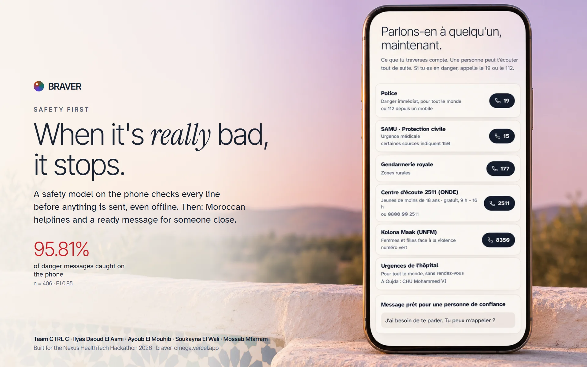
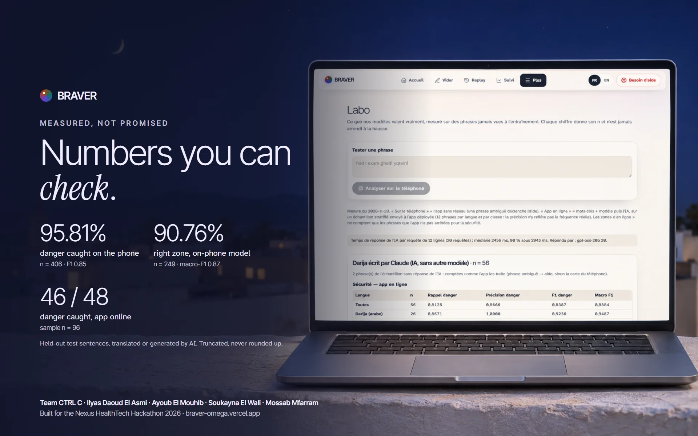
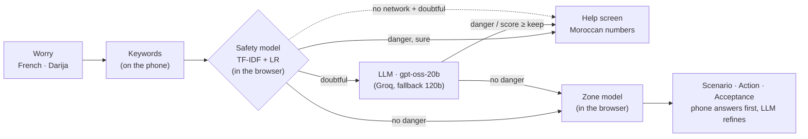
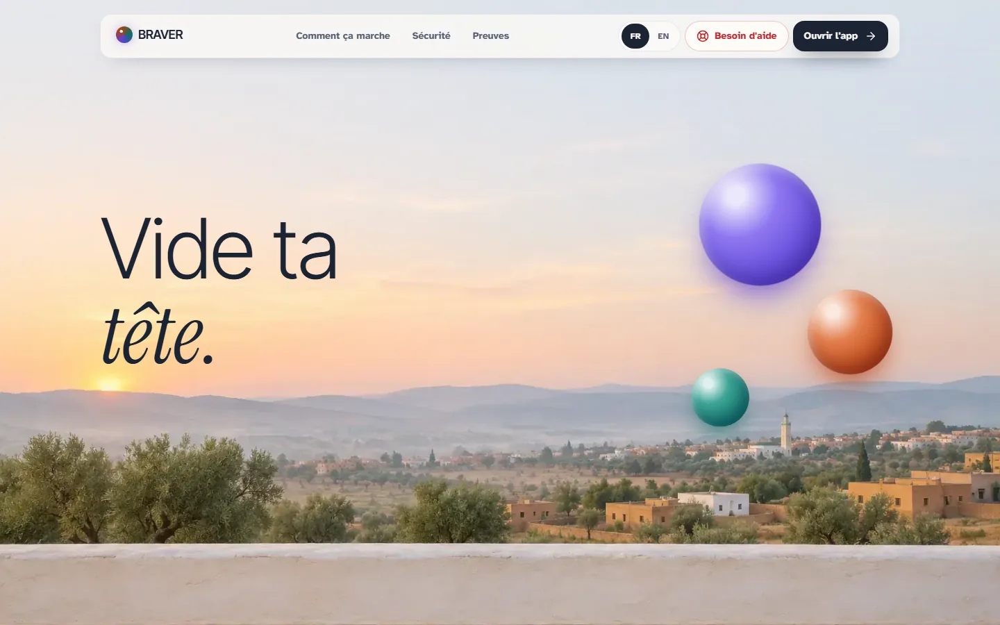
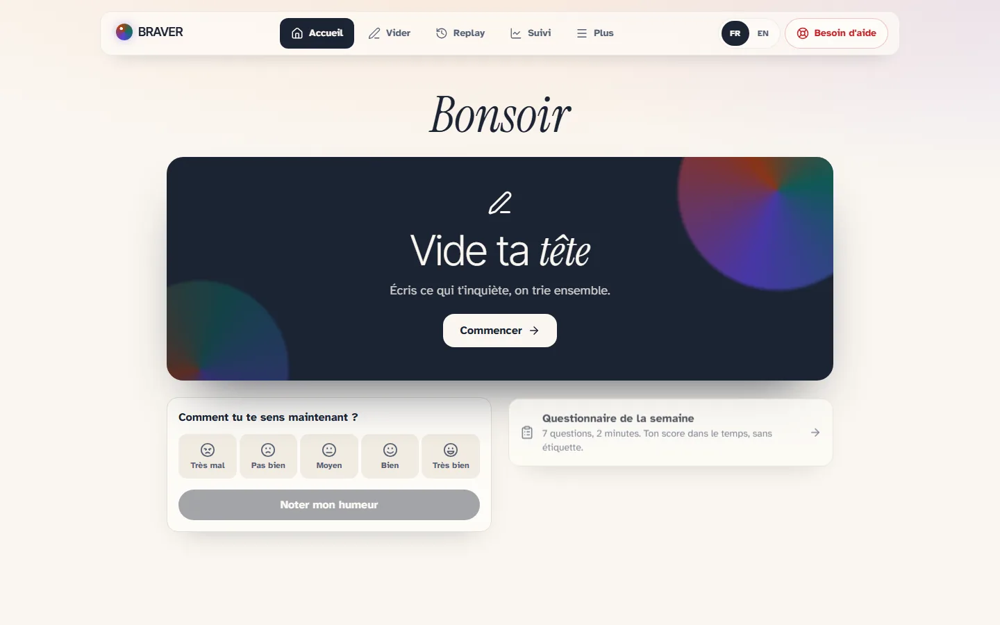
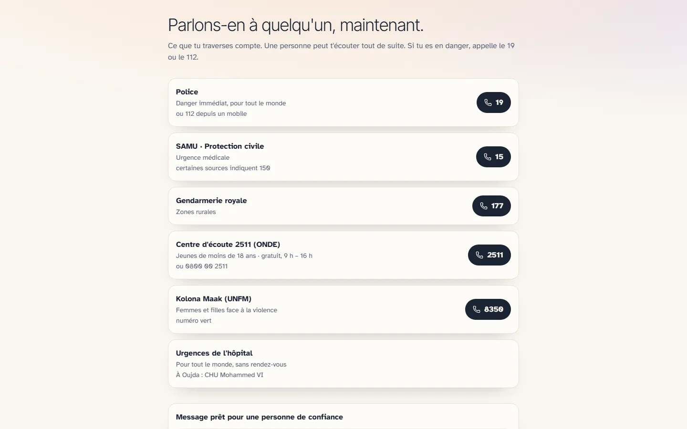
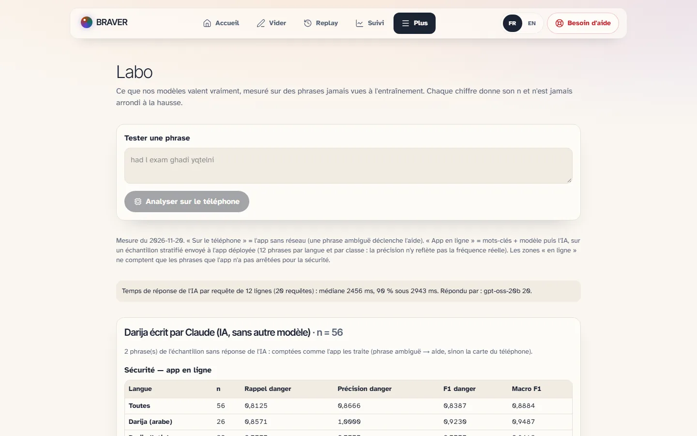

<p align="center">
  
</p>

<h1 align="center">BRAVER</h1>

<p align="center">
  <b>Clear your head.</b> An AI that helps young people sort their worries,<br>
  face what they can, and accept what they can't. In French and Darija.
</p>

<p align="center">
  <a href="https://braver-omega.vercel.app"></a>
  
  
  
  
</p>

<p align="center"><sub>Built for the Nexus HealthTech Hackathon 2026 · Oujda, Morocco · Team CTRL C</sub></p>

<p align="center">
  
</p>

---

## Why BRAVER

Stress, panic and overthinking are everywhere, and many young people go through them in silence: no one to talk to, no money for a professional, or an entourage that doesn't take it seriously. Most apps answer with reassurance — *"don't worry, everything is fine"* — which doesn't hold up for long.

BRAVER is not a *safe place* that only reassures. It is a **brave place**: you write what worries you, and it helps you face what depends on you, accept what doesn't, and reach a professional when it goes beyond what an app can do.

## How it works: three zones



You write one worry per line, in French or Darija (Latin or Arabic letters). Each worry goes into one zone, and each zone has exactly one thing to do:

| Zone | What it is | What BRAVER does |
|---|---|---|
| **Scenario** (violet) | A prediction or interpretation — *"I'm going to fail my exam."* | Note the prediction and how sure you are. Later, **Replay** compares it with what really happened. Any probability shown comes from *your own* history, computed in code — never invented by the AI. |
| **Action** (orange) | A real problem you can act on — *"I haven't started my report."* | One step under 15 minutes, your fear noted before, and a 10-minute timer. |
| **Acceptance** (teal) | Real, but out of your control — *"My father is ill."* | Acknowledge it, then keep one thing that still depends on you. |

Around it: onboarding and consent, a mood check-in, progress over 24 h / 7 d / 30 d, a breathing exercise (cyclic sighing), a weekly GAD-7 (score and trend only, never a label), short reading cards, and a **Labo** page that shows every measured number.

## Safety first



- A **safety model runs on the phone**, in the browser, before anything is sent — so it also works with no network.
- The online LLM only decides **doubtful** cases. If the on-phone score stays high (≥ 0.5440, chosen on validation), **the alert is kept** even if the LLM says no.
- A danger opens a calm **help screen**: Moroccan numbers (19, 112 from a mobile, 15, 177, 2511 ONDE for under-18s, 8350 Kolona Maak) and a ready message for someone close — *« J'ai besoin de te parler. Tu peux m'appeler ? »*
- **No reassurance in code:** a guard filters phrases like *"tout va bien"*, *"ne t'inquiète pas"*, *"ça va aller"* or *"ma tkhafch"* before they reach the screen.
- **No account, no database.** Data stays on the phone; only the sentence being sorted is sent, with no identifier.

## Measured, not promised



All numbers are measured on **held-out test sentences never used for training or tuning**, and **truncated, never rounded up**. Full details per language on the [Labo page](https://braver-omega.vercel.app/labo) and in [`ml/eval/results/`](ml/eval/results/).

**Safety model (on the phone)** — test n = 807

| Class | Precision | Recall | F1 | n |
|---|---|---|---|---|
| **Danger** | 0.7642 | **0.9581** | 0.8502 | 406 |
| No danger | 0.9429 | 0.7007 | 0.8040 | 401 |
| Macro F1 / accuracy | | acc. 0.8302 | 0.8271 | 807 |

Danger recall per language: French 0.9552 · Darija (Latin) 0.9701 · Darija (Arabic) 0.9552 · English 0.9560. With the full app online (stratified sample, n = 96): **46 / 48** danger messages caught, 11 / 48 false alarms.

**Zone model (on the phone)** — test n = 249

| Zone | Precision | Recall | F1 | n |
|---|---|---|---|---|
| Scenario | 0.9662 | 0.8686 | 0.9148 | 99 |
| Action | 0.9237 | 0.9819 | 0.9519 | 111 |
| Acceptance | 0.7380 | 0.7948 | 0.7654 | 39 |
| Macro F1 / accuracy | | acc. 0.9076 | 0.8774 | 249 |

Zone labels: two AIs agree at 92.84 % (Cohen's κ 0.8880, n = 559); a team member checked 100 random labels: 92 / 100 agree (κ 0.8744, with the AI labels visible). Online sorting latency: median 2.4 s for up to 12 worries (n = 20 requests).

> **Honest limits.** Most test sentences are translated or generated by an AI: 429 of the 807 safety test sentences are original English Reddit posts, while the French and Darija sentences and all zone sentences are AI-made. No real BRAVER user wrote any of them. Favouring danger recall means false alarms (one tap, *« On s'est mal compris »*, undoes them). Indirect goodbyes in Darija can still slip through. BRAVER is **not a medical service** and gives no diagnosis.

## Architecture



- **Models trained by us** (Python, scikit-learn): character TF-IDF (2–5) + logistic regression for safety and for zones. Exported as JSON and run in **TypeScript in the browser**; a parity test proves Python and TypeScript give the same probabilities (|Δ| < 1e-6).
- **Used, not trained:** `openai/gpt-oss-20b` on Groq (fallback `gpt-oss-120b`) for doubtful cases and finer sorting; `multilingual-e5-small` for an optional memory, off by default.

## Gallery

| | |
|---|---|
|  |  |
|  |  |

French versions of the posters (4:5, for social media): [`docs/showcase/social/`](docs/showcase/social/) · Short motion loop as video: [`docs/showcase/braver-loop.mp4`](docs/showcase/braver-loop.mp4) · Pitch decks (FR): [`docs/pitch/`](docs/pitch/).

## Data and licences

| Source | Licence | Use |
|---|---|---|
| [`vibhorag101/suicide_prediction_dataset_phr`](https://huggingface.co/datasets/vibhorag101/suicide_prediction_dataset_phr) (Reddit) | MIT | safety training and test |
| [`nvidia/Aegis-AI-Content-Safety-Dataset-2.0`](https://huggingface.co/datasets/nvidia/Aegis-AI-Content-Safety-Dataset-2.0) | CC-BY-4.0 | safety (danger prompts re-checked by a second model) |
| Translations to French and Darija, synthetic sentences | generated by AI for BRAVER, labelled *synthetic* everywhere | safety, zones, Darija tests |

Data cards: [`ml/safety/DATA_CARD.md`](ml/safety/DATA_CARD.md) · [`ml/zones/DATA_CARD.md`](ml/zones/DATA_CARD.md). The safety data contains texts about self-harm from the public datasets above.

## Run it locally

```bash
npm install
cp .env.example .env.local   # then paste GROQ_API_KEY (https://console.groq.com/keys)
npm run dev                  # http://localhost:3000
```

Checks before every push:

```bash
npm run lint && npm run typecheck && npm test && npm run build
```

ML (Python 3.11+):

```bash
python -m venv ml/.venv
ml/.venv/Scripts/python -m pip install -r ml/requirements.txt   # macOS/Linux: ml/.venv/bin/python
ml/.venv/Scripts/python -m pytest ml
```

Without a Groq key the app still works: sorting and safety run on the phone.

<details>
<summary><b>Where things are</b></summary>

```
app/(screens)/<screen>/page.tsx   screens with the tab bar (accueil, vider, tri, replay, suivi, plus, respirer, gad7, cartes, labo)
app/(flow)/onboarding             onboarding without the tab bar
app/api/*/route.ts                server routes (sorting via Groq)
components/landing/               scroll-driven landing page (GSAP ScrollTrigger + Framer Motion)
lib/                              store, safety pipeline, guards, helplines, i18n
ml/safety · ml/zones · ml/eval    training, exported models, evaluation (Python)
public/models/                    on-device model weights (JSON)
docs/pitch/                       pitch decks and their builders
legacy/                           the first prototype (HTML/JS), kept for reference
```

Project rules for contributors and coding agents: [CLAUDE.md](CLAUDE.md).
</details>

## Team CTRL C

| | Field | School |
|---|---|---|
| **Ilyas Daoud El Asmi** — team lead | Computer engineering | EHEI Oujda |
| **Ayoub El Mouhib** | Computer engineering | EHEI Oujda |
| **Soukayna El Wali** | Industrial systems engineering | EHEI Oujda |
| **Mossab Mfarram** | Computer engineering | EHEI Oujda |

Built for the **Nexus HealthTech Hackathon 2026** (Oujda), organised by the École Supérieure de Technologie d'Oujda, the Centre International de Recherche Multidisciplinaire en Sciences de la Santé and HECI Business School.

---

<p align="center"><sub>
BRAVER is a prevention tool, not a medical service, and gives no diagnosis.<br>
In immediate danger in Morocco: <b>19</b> (or <b>112</b> from a mobile) · <b>15</b> medical emergency.
</sub></p>
